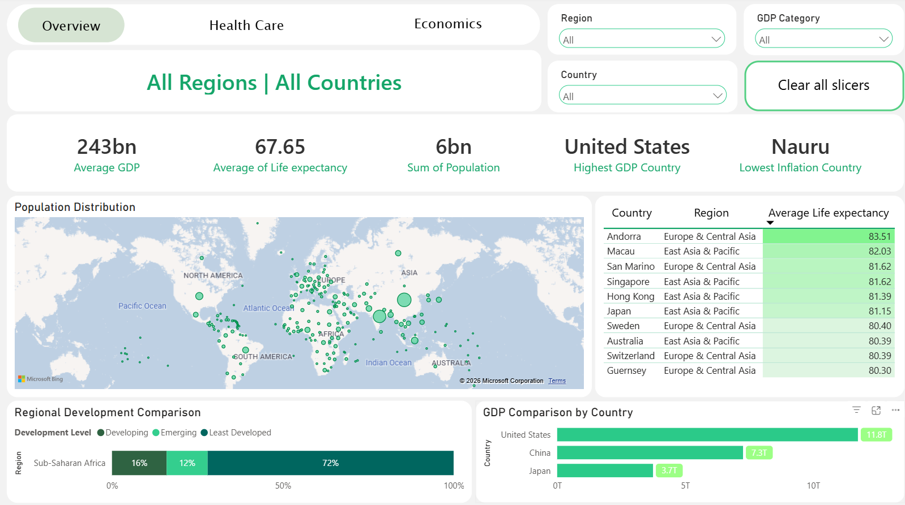
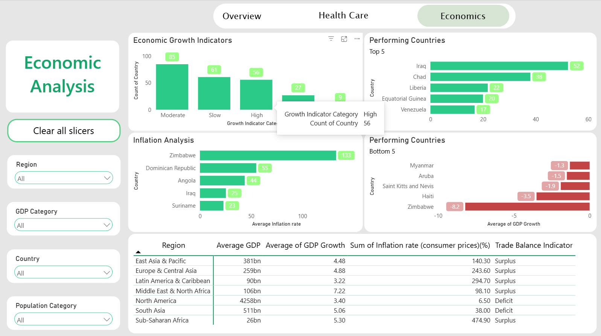
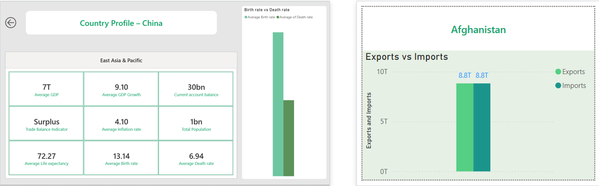

# Country Development and Economic Performance Dashboard

An interactive Power BI report that compares 237 countries and territories across economic, health, population and trade indicators.

This is Mini-Project 3 of the Business Intelligence track at Digital Egypt Pioneers Initiative (DEPI).

## The scenario

An international research organization wants one place to monitor and compare development indicators across countries and regions. Senior management needs to compare economic performance between countries, monitor development indicators, spot high-growth and low-growth regions, see how health and economic factors relate, and support policy and investment decisions.

My job was to take a raw country-level dataset, clean it, model it, and turn it into a dashboard that a decision-maker can use without help.

## What is in the report

Page 1, Executive Overview: five KPI cards (Average GDP, Average Life Expectancy, Total Population, Highest GDP Country, Lowest Inflation Country), a population map, top countries by GDP, development level by region, and a country ranking table.

Page 2, Health Care Analysis: life expectancy by region, birth rate vs death rate, a health indicator matrix, and a scatter plot of GDP per capita against life expectancy.

Page 3, Economic Analysis: imports vs exports, inflation, GDP growth categories, top and bottom 5 countries by GDP growth, and a regional economic comparison.

Two hidden pages support the report: Country Profile (a drill-through page opened by right-clicking a country) and Tooltip - Country (a tooltip that appears on hover).

Interactivity includes Region, Country and GDP Category slicers, a Clear all slicers button, page navigation buttons, cross-filtering between visuals, drill-through, tooltips, and titles that change with the current selection.

## Data

The dataset was provided by the initiative and is shared here with permission. It has one row per country or territory and about 45 columns, covering population, GDP, life expectancy, inflation, exports, imports, birth and death rates, and more.

Some things to know before reading any number in this report:

- It is a single snapshot. There is no year column, so there are no trend charts.
- It looks like an older release. For example, Serbia and Montenegro still appear as one entity.
- It has no education indicator, even though the brief mentions education. The report covers health and economic factors only.
- The file has no Region column. I added one with a mapping table.

## Data cleaning

This was the hardest part of the project. In short:

1. Fixed the header. The file had an extra row of Column1, Column2 and so on at the top, and a row of data types (String, double) under the real headers.
2. Converted every numeric column from text to a proper number type.
3. Removed the "#European Union" row. It is an aggregate of its member states, so keeping it double-counts population and GDP and shows up as a country in rankings.
4. Removed rows that have neither GDP nor population, mostly uninhabited islands and territories.
5. Standardized country names so the map can find them. For example, "Bahamas The" became "Bahamas", "Korea North" became "North Korea", and "Burma" became "Myanmar".
6. Added a Region column by merging a country-to-region mapping table.
7. Removed columns that no visual or requirement needed, such as oil and gas figures, railways, highways and telephones, mostly because they were missing for more than half of the countries.
8. Left missing values as null instead of replacing them with 0. A zero would be counted as a real value and pull every average down.
9. Created four calculated columns:

GDP Category: Low below $5B, Medium from $5B to $50B, High above $50B.
Population Category: Small below 1M, Medium from 1M to 10M, Large above 10M.
Development Level (based on GDP per capita): Low below $3,000, Medium from $3,000 to $11,000, High above $11,000.
Growth Indicator Category (based on GDP growth): Low below 3%, Moderate from 3% to 5%, High above 5%.

The thresholds are rounded versions of the dataset's own tertiles. A country with a missing value is labeled No Data instead of being forced into Low.

Full details are in docs/Data_Cleaning.md.

## Model and DAX

The model is one main table (CountryData) with a Region to Country hierarchy, fields grouped by theme (economic, health, population, trade), and the Country column set as a geographic field for the map.

Main measures (full code in docs/DAX_Measures.md):

- Average GDP: mean GDP of the selected countries.
- GDP Growth Indicator: a Low, Moderate or High label from average GDP growth.
- Population Density Indicator: total population divided by total area, shown as a density label.
- Average Birth Rate and Average Death Rate: simple averages across countries.
- Trade Balance Indicator: Surplus or Deficit, using only countries that report both exports and imports.
- Highest GDP Country and Lowest Inflation Country: the name of the top or bottom country in the current selection.
- Country ranking measures: RANKX-based ranks that respect the slicers.
- Dynamic titles: titles that change with the Region and Country selection.
- Color measures: drive the conditional formatting for growth and trade balance.

Functions used: SUM, AVERAGE, CALCULATE, DIVIDE, IF, FILTER, RANKX, TOPN, MAXX, SELECTEDVALUE, HASONEVALUE and ISFILTERED.

## Key insights

These were calculated from the cleaned dataset. The full write-up is in docs/Business_Insights.md.

1. Wealth and health move together. Countries with GDP per capita above $11,000 average 76.8 years of life expectancy (77 countries). Below $3,000 it is 56.5 years (76 countries).

2. The health gap between regions is large. Average life expectancy is about 49.8 years in Sub-Saharan Africa and 78.8 in North America. Infant mortality is about 81 versus 6 deaths per 1,000 live births. South Asia is the next weakest, at 60.5 years and 74 per 1,000.

3. Higher inflation goes with lower life expectancy. The rank correlation across 218 countries is about -0.43. Median inflation is 2.3% in the richer group and 5.7% in the poorer one. 29 of 221 countries are above 10%, led by Zimbabwe (133%), the Dominican Republic (55%) and Angola (44%).

4. Fast growth does not mean rich. GDP growth has almost no rank correlation with GDP per capita (-0.08). Iraq (52%) and Chad (38%) top the growth list, helped by very small or unusual starting points. North America has the lowest average growth (3.4%) but by far the largest average GDP.

5. The economic map is concentrated. The ten largest economies make up about 65% of the combined GDP in the dataset, and the United States alone about 21%. Five countries (China, India, the United States, Indonesia and Brazil) hold roughly 48% of the population.

## Recommendations

1. Put health investment first where the gap is widest. Sub-Saharan Africa and South Asia combine the lowest life expectancy with the highest infant mortality.

2. Flag high-inflation countries for economic support. A simple screen (inflation above 10%) already isolates 29 countries, and it tracks with weaker health outcomes.

3. Do not screen for growth alone. Pair GDP growth with GDP per capita and economy size, otherwise high growth is mostly small economies recovering from a low base.

## Limitations

- One year only, so there are no trends and no causal claims. The relationships here are descriptive.
- Average birth rate, death rate and similar measures are simple averages across countries, not weighted by population.
- Several indicators have many missing values, so some averages rest on fewer countries than the total.
- Extreme values such as Zimbabwe's inflation and Iraq's growth are kept as they appear in the data and are noted rather than removed.
- The region groupings are my own mapping, so a different grouping would change the regional averages.

## What was hard and what I learned

The two biggest hurdles were null values with a messy file structure, and the number of DAX measures the project required. Deciding what to do with missing data, and why, took more thought than any chart.

By the end of the project I could build a professional multi-page Power BI dashboard, design an executive KPI system, write DAX for analytical reporting, design interactive visual reports, run a country comparison analysis, and present BI work clearly to a non-technical audience.

## Repository structure

- README.md
- LICENSE
- data/country_data_comp.xlsx
- data/Region_Map.xlsx
- powerbi/Country_Development_Dashboard.pbix
- docs/Data_Cleaning.md
- docs/DAX_Measures.md
- docs/Business_Insights.md
- images/ (dashboard screenshots)
- presentation/Country_Development_Dashboard.pdf

## How to open the report

1. Install Power BI Desktop (free, Windows).
2. Download powerbi/Country_Development_Dashboard.pbix.
3. Open it. If Power BI asks for the data source, point it to the files in the data folder.

## Tools

Power BI Desktop, Power Query (M), DAX and Excel.

## Acknowledgements

A Special Thank you to Abdulrahman Ashour and Digital Egypt Pioneers Initiative (DEPI) for the guidance, time and effort behind this program, and for providing the dataset.

## License

Code, documentation and report files are under the MIT license (see LICENSE). The dataset belongs to its provider and is included with their permission.

## Contact

Youssef Sholkamyi
LinkedIn: https://www.linkedin.com/in/youssef-sholkamyi-274ab0379/
